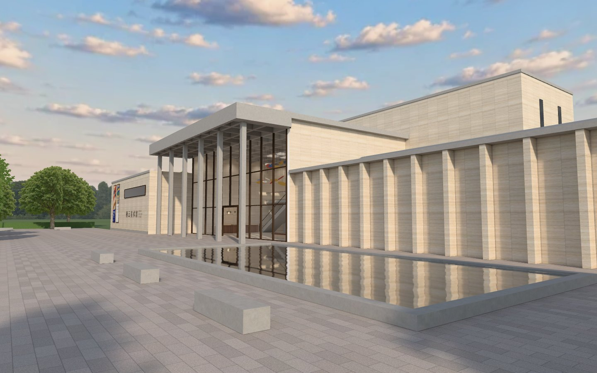
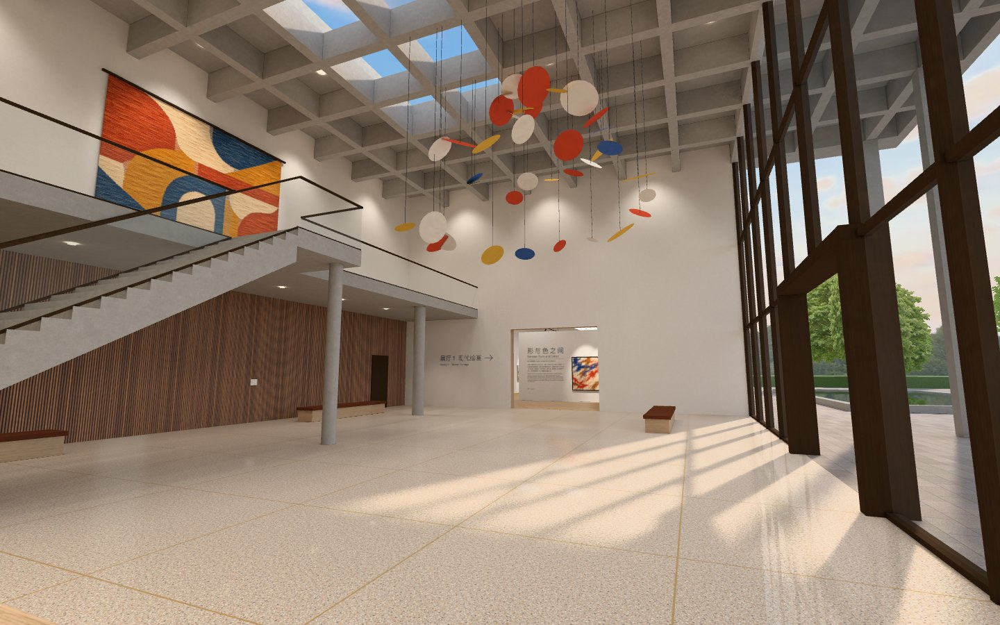
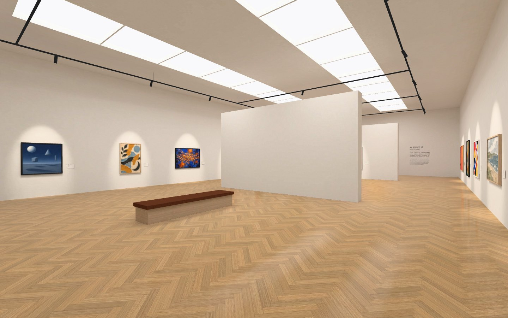

# Art Museum · 艺术博物馆

用 [three.js](https://threejs.org) 搭建的一座当代美术馆，由三个部分组成，都在同一座建筑里，可以连续走通：

- **建筑外观**：整栋建筑完整建模，坐落在一片石材广场上。洞石立面、十一道竖向石鳍的展厅翼、高柱廊下的玻璃幕墙大厅、倒影池、树池和一件红色钢板雕塑，可以环绕观看。
- **大厅**：十米高的井格梁天花和天窗，侧光穿过幕墙斜扫水磨石地面；洞石墙、胡桃木格栅、通往夹层的混凝土楼梯、中庭吊饰和一幅 5.4 米宽的挂毯。
- **现代绘画展厅**：人字拼橡木地板、白墙、发光天棚和轨道射灯，两道独立展墙，挂着 16 幅原创画作，每幅都有展签。





更多预览图在 `preview/`。

在线浏览：https://yxengram.github.io/3D/art-museum/

## 这个场景想解决什么

上一个场景（被自然收回的城市街角）每帧要画约 540 万个三角形、占约 1.37 GB 显存。这个场景反过来做：**几何尽量简单，细节交给贴图，光影全部预先烘焙**，在尽可能精致的前提下把硬件需求压到很低。

- 整个模型只有约 **7,400 个三角形**（每帧最多画约 2 万个，含倒影），墙、地、梁、楼梯基本都是方盒子和平面。
- **没有任何实时灯光和实时阴影**。太阳、天光、天窗、发光天棚和 60 多盏筒灯、射灯的直接光与多次反弹，都用 Blender Cycles 预先算好，烘进三张 2048×2048 的光照贴图（外观、大厅、展厅各一张）。运行时每个表面只做一次「材质贴图 × 光照贴图」，着色器和不受光的纯色材质一样便宜。
- 石材分缝、人字拼地板、木格栅、水磨石铜条这些图案全部画在贴图里，不占几何。
- 只有三处是随视角变化、烘不进贴图的，用了便宜的办法：抛光地面的倒影用启动时拍一次的立方体贴图加盒投影修正；倒影池用一张 768×512 的平面反射（只在看得见水池时渲染）；玻璃只反射天空。

## 运行

- **在线**：直接打开上面的链接。
- **本地**：贴图和模型是独立文件，浏览器不允许网页用 `file://` 读取它们，所以需要一个本地服务器：

  ```bash
  cd art-museum
  python3 -m http.server 8765
  ```

  然后打开 http://localhost:8765/ 。
- **想要双击就能打开的单文件版**：在本目录运行 `npm install && node tools/bundle.mjs`，会生成 `dist/艺术博物馆.html`（约 15 MB，three.js、模型和全部贴图都内嵌在里面，不需要服务器，也不需要联网）。

### 操作

页面底部有三个标签：**外观 / 大厅 / 展厅**，点击或按数字键 `1` `2` `3` 切换。

| | 外观（环视） | 大厅、展厅、广场（行走） |
| --- | --- | --- |
| 拖动 | 绕建筑旋转、升降视角 | 转动视线 |
| 滚轮 / 双指 | 拉近拉远 | 拉近看画（改变视角宽窄） |
| 点击地面 | — | 走到那个位置 |
| `W` `A` `S` `D` 或方向键 | — | 行走，按住 `Shift` 加快 |

三个部分是连通的：在行走模式下可以从大厅正门走到广场上，也可以穿过大厅东墙的门洞走进展厅，标签会随位置自动切换，画面曝光也会像眼睛适应明暗那样自动过渡。

地址参数：`?view=lobby` 或 `?view=gallery` 直接从室内开始；`?dpr=1` 固定用较低的渲染分辨率；`?aa=1` / `?aa=0` 强制开关多重采样抗锯齿。

## 性能

实测环境：Apple M1 Max，Chromium（Playwright 无头模式，ANGLE Metal），关闭垂直同步后测得的上限帧率；显存是脚本统计页面向 WebGL 申请的全部缓冲、贴图和渲染缓冲，加上画布缓冲的估算值。

| 配置 | 外观 | 大厅 | 展厅 | 显存合计 |
| --- | --- | --- | --- | --- |
| 1440×900 @2x（渲染 2880×1800，默认：高分屏不开 MSAA） | 500 fps | 476 fps | 476 fps | 约 295 MB |
| 1440×900 @2x，`?aa=1`（4× MSAA） | 435 fps | 455 fps | 476 fps | 约 414 MB |
| 1920×1080 @1x（默认：4× MSAA） | 435 fps | 455 fps | 476 fps | 约 307 MB |

| | 外观 | 大厅 | 展厅 |
| --- | --- | --- | --- |
| 绘制调用 / 帧 | 135 | 31 | 42 |
| 三角形 / 帧 | 约 1.95 万 | 约 7,800 | 约 6,500 |

- 模型本身只有 **7,412 个三角形**；外观视角的 1.95 万是因为倒影池要把场景再画一遍，再加上天空球。
- 显存里贴图约 214 MB（三张光照贴图 48 MB、17 幅画约 76 MB、其余是材质和文字），画布缓冲约 59 MB（不开 MSAA）到 178 MB（2880×1800 开 4× MSAA）。
- 下载 11.6 MB、49 个请求；本机从打开到可交互约 1.1–1.2 秒。单文件版 15.2 MB。
- 对照上一个场景（被自然收回的城市街角，同一台机器）：每帧约 540 万三角形 → 约 2 万；显存约 1.37 GB → 约 0.3 GB；帧率约 82 → 430 以上。

这些帧率已经被浏览器自身每帧的固定开销限制住了（场景本身每帧只需约 1.2–1.6 毫秒），所以三种配置之间差别很小。

没有在其他机器、手机或 Safari / Firefox 上实测过。页面带一个简单的分辨率调节：连续掉帧时自动降低渲染分辨率，帧率恢复后再升回去。

## 素材

没有下载任何外部素材。16 幅画、挂毯和全部材质贴图都由 GPT-Image 生成，或用生成的原图在代码里拼合；馆名、展签、导视和旗幡是用系统字体在代码里排版的。画作的作者、标题、年份均为虚构。逐项清单见 [SOURCES.md](./SOURCES.md)，每张图的完整提示词在 `sources/*.json`。

## 目录

```
index.html        成品页面（three.js 已打包在内），和 assets/ 一起部署
dev.html          开发页面，从 node_modules 加载 three.js
assets/           运行时资源：scene.glb、scene.json、三张光照贴图、tex/ 材质、art/ 画作、gfx/ 文字
src/              运行端源码：main.js（加载与主循环）、materials.js（材质与着色器）、controls.js（环视与行走）
tools/bl/         Blender 脚本：scene.py（建模）、materials.py（材质表）、lib.py（图集、烘焙、降噪、导出）、build.py（入口）
tools/tex/        贴图后处理与排版脚本，以及当时给生成任务的规格说明
tools/*.mjs       bundle（打包）、shot（无头截图）、perf（帧率与显存）、walktest（交互测试）
sources/          每张素材的提示词与处理记录
preview/          预览图
```

## 重新构建

需要 Node.js、Blender（5.2 下验证过，命令行可用）和 `cwebp`；贴图脚本另需 Python（numpy、scipy、Pillow）。

```bash
npm install                              # three、esbuild、playwright-core
# 1. 建模 + 烘焙 + 导出（Apple M1 Max 上约 10 分钟）
blender -b --factory-startup -P tools/bl/build.py -- --out build/final --res 2048 --spp 384 --spp_lobby 768 --spp_gallery 512 --nl_lobby 60 --ship
# 2. 打包：生成 index.html 和 dist/艺术博物馆.html
node tools/bundle.mjs
# 3. 检查
node tools/shot.mjs --cams all --out .shots/check     # 需要先运行一次 npx playwright install chromium
node tools/perf.mjs
```

`tools/tex/*_build.py` 用来从生成的原图重做材质贴图；原图体积较大，没有放进仓库。

## 已知限制

- 只在上面这一台机器、一种浏览器上测过。
- 光照全部是烘焙的：没有昼夜变化，物体不会动（吊饰是静止的），画面里的太阳固定在东南偏东、仰角 30°。
- 夹层和楼梯只是看的，不能走上去。
- 高分屏上默认不开 MSAA，窗棂、吊线这类细线条会有轻微锯齿；加 `?aa=1` 可以打开，代价是画布缓冲多占约 120 MB 显存。
- 树是三片交叉的贴图卡片，从很高的角度看得出是片；环视镜头贴到树跟前时，那棵树会整棵淡出。
- 抛光地面的倒影来自启动时拍的一张立方体贴图，墙和窗的位置是对的，家具的倒影只是近似。
- 贴图没有用 GPU 压缩格式（KTX2）。换成压缩格式可以把贴图显存再降到约四分之一，但下载体积会变大、还要带一个解码器，这次没有做。
- 挂毯的织纹近看偏粗；p05/p08、p12/p15 四幅画是两两合在一张图里生成后裁开的，放大的余量比其他画小。
