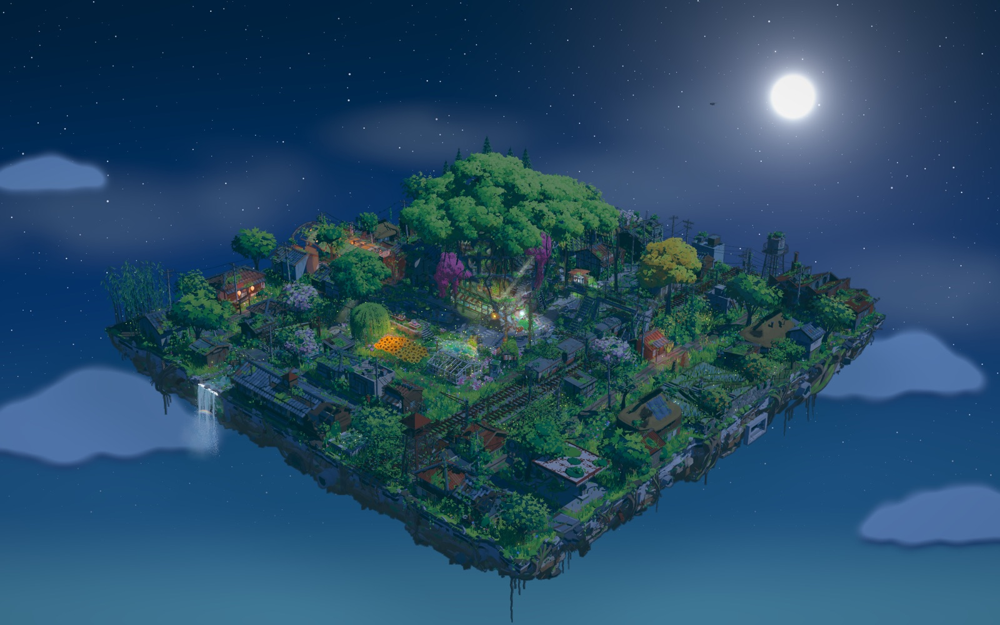

# Reclaimed Street Corner · 被自然收回的城市街角

用 [three.js](https://threejs.org) 搭建的三渲二（日式动画风格）微缩场景：一块 80×80 的方形悬浮基座上，一个被植物重新占据的城市街角。

- **中心区**：半塌的混凝土建筑，巨大的榕树从屋顶破出；室内有浅水、水面焦散、丁达尔光束和植物。
- **外环**：沿新道路分布的 53 栋小建筑，有商店街、铁路道口、水田、神社、学校和加油站。
- **基座侧壁**：可以看到破碎的沥青剖面、裸露的混凝土和钢筋，以及垂下的树根与藤蔓。
- **动态**：风吹草木、水流、瀑布、飞鸟等细微动画。场景里没有人物，页面上也没有任何 UI。
- **夜间模式**：按 `N` 键或双击画面切换昼夜。夜里是月光、星空和约 870 只萤火虫，自动售货机、纸灯笼、石灯笼和闪黄灯的信号灯还亮着。



## 运行

直接双击 `被自然收回的城市街角.html` 即可。所有代码都已打包进这一个文件，不需要安装，也不需要联网。

### 操作

- 左键拖拽旋转
- 滚轮缩放
- 右键拖拽平移
- 按 `N` 键，或在同一位置快速点两下（双击），切换白天和夜晚，过渡约 3 秒

通过服务器打开时，在地址后加 `?night` 可以直接以夜晚开始。

## 开发

`index.html` 是开发页面，从 `node_modules` 加载 three.js，需要先安装依赖，并通过本地服务器打开：

```bash
cd reclaimed-street-corner
npm ci
python3 -m http.server 8765
```

然后在浏览器打开 http://localhost:8765/ 。

修改 `src/` 后，在本目录运行下面的命令，重新生成单文件版本：

```bash
node tools/bundle.mjs
```

夜间模式的实现（灯光贴图、夜空、萤火虫，以及怎样给模块加一盏灯）写在 `MODULE_GUIDE.md` 的 Night 一节。

`tools/` 里的渲染和性能脚本（`shot.mjs`、`perf.mjs`、`gpumem.mjs` 等）依赖 Playwright 的 Chromium，默认从 `~/Library/Caches/ms-playwright` 查找，写法上面向 macOS。`shot.mjs` 加 `--query night`、`perf.mjs` 的第四个参数填 `night`，可以渲染和测量夜晚，例如 `node tools/perf.mjs 2 1440 900 night`。

## 目录结构

```
被自然收回的城市街角.html   打包好的成品，双击打开
index.html                 开发页面
src/
  main.js                  渲染器、后期、相机与碰撞
  core/                    场景约定（layout.js）、卡通材质、小建筑工具（housekit.js）等
  modules/                 各部分场景，每个模块输出一个 build(ctx)；night.js 是夜间的灯光、光晕和萤火虫
tools/                     打包、截图、性能与显存检查脚本
preview/                   夜间模式的预览图
versions/
  v1-24x24/                第一版
  v2-40x40/                第二版
BRIEF.md                   最初的场景要求
EXPANSION_V3.md            扩建到 80×80 的约定和性能目标
MODULE_GUIDE.md            模块开发说明
```

## 性能

以下数字在 Apple M1 Max、2880×1800 的无头 Chromium 中测得：白天和夜晚的中值都约 80 fps，每帧约 540 万三角形、745 次绘制，加载约 8 秒，GPU 占用约 1.37 GB。这个场景对显卡要求较高，集成显卡或手机上帧率会低一些，页面会自动降低渲染分辨率来适应。
